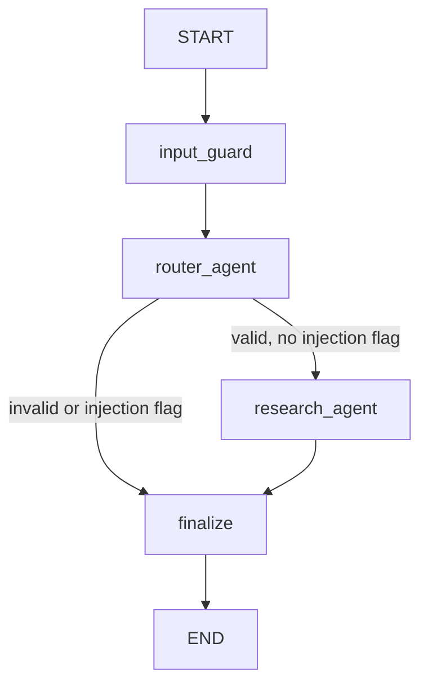

# TaxGuard AI — Architecture and Agent Model

## Runtime path

1. **Streamlit UI** captures question, jurisdiction, applicable date and optional topic.
2. **Input guard** applies best-effort PII redaction before downstream processing.
3. **Request Router Agent** validates schema, date and input length; detects a small set of prompt-injection signals.
4. **Deterministic planner** labels the workflow as `policy_lookup`, `high_impact_review` or `multi_jurisdiction_review`. It is a rule-based planning component, not an LLM planner.
5. **Eligibility filter** restricts candidates by country, effective date and withdrawn status before ranking.
6. **Retrieval** creates TF-IDF and BM25 rankings. RRF fuses them. If optional dependencies and model weights are available and `TAXGUARD_USE_DENSE=true`, Chroma + MiniLM adds a dense semantic ranking to the RRF fusion.
7. **Policy Research Agent** applies a simple evidence gate, returns the highest ranked synthetic excerpts, and validates that citation chunk IDs came from retrieved results.
8. **Finalize/audit** returns a status, source metadata, plan, execution trace and safe audit summary.

## LangGraph concepts

- **State** (`TaxGuardState`): shared typed data passed from node to node, including redacted question, country/date, request object, plan, safety flags, results, response and trace.
- **Node**: a function that reads current state and returns state updates. Implemented graph nodes: `input_guard`, `router_agent`, `research_agent`, `finalize`.
- **Edge**: a transition between nodes. The graph uses normal edges for fixed order and a conditional edge after routing to skip research for invalid or injection-flagged requests.
- **Agent**: a component with a bounded responsibility. This project has a request-router agent and policy-research agent; they are not independently autonomous LLM agents.
- **Planner**: currently deterministic rules that select a workflow label. A model-driven planner is not required for basic country/date lookups and would increase complexity/cost.
- **Memory**: no conversational long-term memory is implemented. Graph state is per-request working state, not persistent user memory. Do not confuse state with memory.
- **Human review**: currently represented by statuses/flags; a production human-review queue and approval UI remain future work.

## Retrieval design

- TF-IDF word uni/bi-grams: lexical similarity ranking.
- BM25: term-frequency/inverse-document-frequency ranking with length normalization.
- RRF: rank fusion, `RRF(d) = sum_r 1 / (k + rank_r(d))`, with `k=60`.
- Optional dense path: `all-MiniLM-L6-v2` generates sentence embeddings and Chroma stores vectors locally. Dense scores are not assumed to be comparable to BM25 scores; RRF combines ranks.
- Eligibility filtering must happen before final selection; a high relevance score cannot make a wrong-country or out-of-date policy eligible.

## State flow diagram

## Security boundary

The corpus is synthetic. PII redaction is regex-based best effort. No raw question text should be written to audit logs. Before external LLM inference, add data minimization, provider review, authorization checks, output validation and retention controls. Retrieved documents are untrusted data, not instructions.
